<div align="center">


<a href="https://github.com/USERNAME">
  
</a>

<br/>


<br/><br/>

</div>

<br/>

## 👋 About Me

```lua
local Me = {
	Name      = "YOUR_NAME",
	Speaks    = { "English", "Bahasa Indonesia" },
	Interests = { "Luau", "Python", "C++" },
	Goal      = "Become a professional Roblox developer",
	Status    = "Beginner",
}

function Me:Greet()
	print("Halo! Hi! 👋  Thanks for stopping by.")
end

Me:Greet()
```

<br/>

## 🗺️ My Roadmap

<div align="center">  </div> <br/>

<br/>

## 🧰 Tech I'm Exploring

<div align="center">

| | Language | Why I'm learning it |
|:-:|:--|:--|
| 🎮 | **Luau** | The language of Roblox. My main focus right now. |
| 🐍 | **Python** | Scripting, automation, and tooling around my projects. |
| ⚙️ | **C++** | Understanding how things work closer to the machine. |

</div>

<br/>

## 🎯 Goals

- [ ] Learn Luau fundamentals
- [ ] Build my first Roblox game
- [ ] Learn Roblox services, events, and DataStore
- [ ] Practice Python through small scripts
- [ ] Learn the basics of C++
- [ ] Publish a game and share it here

<br/>

## 🌍 Languages I Speak

<div align="center">

🇬🇧 **English** &nbsp;·&nbsp; 🇮🇩 **Bahasa Indonesia**

</div>

<br/>

## 📫 Connect With Me

<div align="center">

<a href="https://www.roblox.com/users/TO-BE-DECIDED"></a>
<a href="https://discord.com/users/homicideaddicted"></a>
<a href="mailto:wenlly.chang26ti@mahasiswa.pcr.ac.id"></a>

<br/><br/>

</div>


